<picture><source media="(prefers-color-scheme: dark)" srcset="assets/dark/header-v1.svg"/></picture>

<a href="https://linkedin.com/in/pgabriel1"><picture><source media="(prefers-color-scheme: dark)" srcset="https://img.shields.io/badge/LINKEDIN-0d1117?style=flat-square&logo=linkedin&logoColor=ffffff"/></picture></a>
<a href="mailto:paulogaab21@gmail.com"><picture><source media="(prefers-color-scheme: dark)" srcset="https://img.shields.io/badge/EMAIL-0d1117?style=flat-square&logo=gmail&logoColor=ffffff"/></picture></a>
<a href="https://iacorex.com"><picture><source media="(prefers-color-scheme: dark)" srcset="https://img.shields.io/badge/IACOREX-0d1117?style=flat-square"/></picture></a>
<a href="https://mipaciente.com.br"><picture><source media="(prefers-color-scheme: dark)" srcset="https://img.shields.io/badge/MIPACIENTE-0d1117?style=flat-square"/></picture></a>

<!-- Para ligar o badge do currículo: suba o PDF em assets/ e descomente a linha abaixo.
<a href="assets/Curriculo_Paulo_Gabriel_da_Silva.pdf"><picture><source media="(prefers-color-scheme: dark)" srcset="https://img.shields.io/badge/RESUME-0d1117?style=flat-square&logo=adobeacrobatreader&logoColor=ffffff"/></picture></a>
-->

<picture><source media="(prefers-color-scheme: dark)" srcset="assets/dark/s01.svg"/></picture>
<picture><source media="(prefers-color-scheme: dark)" srcset="assets/dark/whoami.svg"/></picture>

<picture><source media="(prefers-color-scheme: dark)" srcset="assets/dark/s02.svg"/></picture>
<picture><source media="(prefers-color-scheme: dark)" srcset="assets/dark/ecosystem.svg"/></picture>

<picture><source media="(prefers-color-scheme: dark)" srcset="assets/dark/s03.svg"/></picture>
<picture><source media="(prefers-color-scheme: dark)" srcset="assets/dark/projects.svg"/></picture>

[iacorex.com](https://iacorex.com) &nbsp;·&nbsp; [mipaciente.com.br](https://mipaciente.com.br) &nbsp;·&nbsp; [ufc3recomp](https://github.com/paulogaab21/ufc3recomp) &nbsp;·&nbsp; [NotiGO](https://github.com/paulogaab21/NotiGO) &nbsp;·&nbsp; [reblue-ptbr-texture-fix](https://github.com/paulogaab21/reblue-ptbr-texture-fix) &nbsp;·&nbsp; [Fable2Recomp](https://github.com/Fable2Recomp/Fable2Recomp)

<picture><source media="(prefers-color-scheme: dark)" srcset="assets/dark/s04.svg"/></picture>

<picture><source media="(prefers-color-scheme: dark)" srcset="https://github-readme-stats.vercel.app/api?username=paulogaab21&show_icons=true&hide_border=true&bg_color=00000000&title_color=dddddd&text_color=999999&icon_color=aaaaaa"/></picture>
<picture><source media="(prefers-color-scheme: dark)" srcset="https://github-readme-stats.vercel.app/api/top-langs/?username=paulogaab21&layout=compact&hide_border=true&bg_color=00000000&title_color=dddddd&text_color=999999"/></picture>

<picture><source media="(prefers-color-scheme: dark)" srcset="https://github-readme-activity-graph.vercel.app/graph?username=paulogaab21&bg_color=00000000&color=ffffff&line=ffffff&point=ffffff&area_color=ffffff&area=true&hide_border=true&radius=0&custom_title=CONTRIBUTION%20TELEMETRY"/></picture>

<picture><source media="(prefers-color-scheme: dark)" srcset="assets/dark/s05.svg"/></picture>
<picture><source media="(prefers-color-scheme: dark)" srcset="assets/dark/timeline.svg"/></picture>

<picture><source media="(prefers-color-scheme: dark)" srcset="assets/dark/s06.svg"/></picture>
<picture><source media="(prefers-color-scheme: dark)" srcset="assets/dark/stack.svg"/></picture>

<picture><source media="(prefers-color-scheme: dark)" srcset="assets/dark/footer.svg"/></picture>
